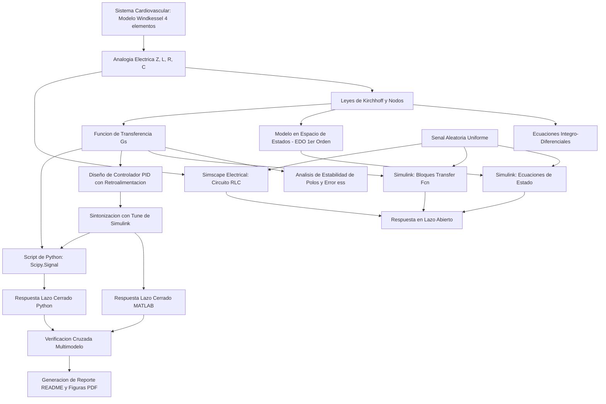

[](https://matlab.mathworks.com/open/github/v1?repo=NayeliBonilla/MSF-Practica2)

# Práctica 2 — Modelado y control del sistema cardiovascular mediante el modelo Windkessel

Repositorio académico de la asignatura **Modelado de Sistemas Fisiológicos**, correspondiente al programa de **Ingeniería Biomédica** del Tecnológico Nacional de México / Instituto Tecnológico de Tijuana.

Esta práctica aborda el modelado dinámico del sistema cardiovascular mediante el circuito equivalente Windkessel de 4 elementos ($Z, L, R, C$), evaluando las respuestas hemodinámicas ante tres condiciones patofisiológicas: **Normotenso**, **Hipotenso** e **Hipertenso**. Además, se diseña e implementa un **controlador PID con retroalimentación negativa** para restaurar la presión arterial periférica $P_p(t)$ del paciente a los valores fisiológicos de referencia.

**Docente:** Dr. Paul Antonio Valle Trujillo  
**Correo:** paul.valle@tectijuana.edu.mx  
**Departamento:** Ingeniería Eléctrica y Electrónica  
**Institución:** Tecnológico Nacional de México / Instituto Tecnológico de Tijuana  
**Asignatura:** Modelado de Sistemas Fisiológicos (IBF-1020)  
**Programa:** Ingeniería Biomédica  
**Estudiante:** Nayeli Bonilla Martínez · No. Control: 22212381 · l22212381@tectijuana.edu.mx  

**Repositorio de la asignatura:** https://github.com/DrPaulValle/MSF-IBF1020  
**Sede:** Blvd. Alberto Limón Padilla s/n, Tijuana, C. P. 22454, B. C., México.

---

<a id="contenido"></a>
## Contenido

1. [Resumen](#resumen)
2. [Competencia y objetivos](#objetivos)
3. [Relación con el temario](#temario)
4. [Modelo físico y analogía eléctrica (Windkessel)](#analogia)
5. [Formulación matemática y espacio de estados](#modelo)
6. [Análisis temporal, estabilidad y polos](#analisis)
7. [Señales de entrada y condiciones de simulación](#senales)
8. [Implementación en MATLAB, Simulink y Simscape](#matlab)
9. [Diseño del controlador PID](#controlador)
10. [Implementación en Python](#python)
11. [Resultados y verificación cruzada](#resultados)
12. [Flujo de trabajo](#flujo)
13. [Actividades del estudiante](#actividades)
14. [Estructura del repositorio](#estructura)
15. [Requisitos](#requisitos)
16. [Reproducibilidad y entregables](#reproducibilidad)
17. [Conclusiones](#conclusiones)
18. [Referencias](#referencias)

---

<a id="resumen"></a>
## Resumen

El propósito de esta práctica es **modelar, analizar y controlar la dinámica de la presión cardiovascular** utilizando el modelo analógico de Windkessel de 4 elementos. A partir de las leyes de Kirchhoff se deducen el modelo integro-diferencial, la representación en espacio de estados de primer orden y la función de transferencia $G(s) = P_p(s) / P_a(s)$.

Se simulan tres escenarios fisiológicos variando la compliancia arterial $C$:
- **Normotenso (Control):** $C = 1.500\text{ mL/mmHg}$
- **Hipotenso (Caso 1):** $C = 3.500\text{ mL/mmHg}$
- **Hipertenso (Caso 2):** $C = 1.000\text{ mL/mmHg}$

Posteriormente, se implementa un **controlador PID** en lazo cerrado para llevar las respuestas alteradas (hipotenso e hipertenso) al comportamiento de la señal de referencia normotensa, verificando la consistencia entre simulaciones en **MATLAB/Simulink/Simscape** y scripts de **Python**.

**Palabras clave:** Modelo Windkessel; sistema cardiovascular; controlador PID; impedancia característica; compliancia vascular; espacio de estados; simulación *in silico*; MATLAB; Python.

[Volver al contenido](#contenido)

---

<a id="objetivos"></a>
## Competencia y objetivos

### Competencia a desarrollar
Comprender y aplicar los principios de modelado en espacio de estados, funciones de transferencia y diseño de controladores en lazo cerrado aplicados al sistema cardiovascular, analizando las variaciones hemodinámicas bajo distintas condiciones patológicas mediante herramientas computacionales.

### Objetivos específicos
- Formular las ecuaciones diferenciales del circuito Windkessel de 4 elementos aplicando las leyes de Kirchhoff.
- Obtener la representación en **espacio de estados** ($\dot{x} = Ax + Bu$, $y = Cx + Du$) y la **función de transferencia** $G(s)$.
- Determinar los polos analíticos del sistema y evaluar la estabilidad en lazo abierto para cada condición fisiológica.
- Diseñar y sintonizar un **controlador PID** para corregir las respuestas de pacientes hipotensos e hipertensos utilizando como referencia la respuesta normotensa.
- Simular el sistema dinámico en MATLAB/Simulink/Simscape y reproducir numéricamente los resultados en Python.
- Documentar las evidencias en GitHub con un flujo de trabajo reproducible.

[Volver al contenido](#contenido)

---
---

<a id="temario"></a>
## Relación con el temario

La práctica integra contenidos correspondientes a las tres unidades principales de la asignatura **Modelado de Sistemas Fisiológicos (IBF-1020)**:

| Unidad | Área | Contenidos aplicados |
|---|---|---|
| I | Sistemas de control retroalimentados | Diagramas de bloques cardiovascular, error en estado estacionario, respuesta temporal ante entradas estocásticas y análisis de estabilidad de polos |
| II | Modelado matemático | Analogía hidráulica-eléctrica de Windkessel, leyes de Kirchhoff, representación en Variables de Estado y Funciones de Transferencia |
| III | Controladores | Tipos de controladores (PID), sintonización automática in silico, seguimiento de referencias biológicas y sistemas de lazo cerrado |

[Volver al contenido](#contenido)

---


<a id="analogia"></a>
## Modelo físico y analogía eléctrica (Windkessel)

El modelo Windkessel de 4 elementos representa la impedancia de la raíz aórtica, la inercia de la sangre, la distensibilidad de las arterias elásticas y la resistencia periférica total.

| Símbolo | Componente eléctrico | Interpretación fisiológica | Unidades |
|:---:|:---:|:---|:---:|
| $P_a(t)$ | Voltaje de entrada | Presión en la aorta ascendente / VI | $\text{mmHg}$ |
| $P_p(t)$ | Voltaje de salida | Presión arterial periférica | $\text{mmHg}$ |
| $F_a(t)$ | Corriente total | Flujo sanguíneo cardiaco total | $\text{mL/s}$ |
| $Z$ | Resistencia en serie | Impedancia característica aórtica | $\text{mmHg}\cdot\text{s}\cdot\text{mL}^{-1}$ |
| $L$ | Inductancia | Inertancia de la masa sanguínea | $\text{mmHg}\cdot\text{s}^2\cdot\text{mL}^{-1}$ |
| $C$ | Capacitancia | Compliancia / Distensibilidad vascular | $\text{mL}\cdot\text{mmHg}^{-1}$ |
| $R$ | Resistencia en paralelo | Resistencia vascular periférica total | $\text{mmHg}\cdot\text{s}\cdot\text{mL}^{-1}$ |

### Parámetros hemodinámicos por condición

| Parámetro | Hipotenso | Normotenso (Ref.) | Hipertenso | Unidades |
|:---:|:---:|:---:|:---:|:---:|
| **$Z$** | $0.010$ | $0.010$ | $0.010$ | $\text{mmHg}\cdot\text{s}\cdot\text{mL}^{-1}$ |
| **$L$** | $0.001$ | $0.001$ | $0.001$ | $\text{mmHg}\cdot\text{s}^2\cdot\text{mL}^{-1}$ |
| **$R$** | $1.000$ | $1.000$ | $1.000$ | $\text{mmHg}\cdot\text{s}\cdot\text{mL}^{-1}$ |
| **$C$** | **$3.500$** | **$1.500$** | **$1.000$** | $\text{mL}\cdot\text{mmHg}^{-1}$ |

[Volver al contenido](#contenido)

---

<a id="modelo"></a>
## Formulación matemática y espacio de estados

### 1. Ecuaciones integro-diferenciales
Por conservación del flujo en los nodos (LKC):

$$F_a(t) = F_Z(t) + F_L(t) = F_C(t) + F_R(t)$$

Sustituyendo las relaciones constitutivas de cada elemento:

$$\frac{P_a(t) - P_p(t)}{Z} + \frac{1}{L}\int \left(P_a(t) - P_p(t)\right) dt = C \frac{dP_p(t)}{dt} + \frac{P_p(t)}{R}$$

### 2. Función de transferencia $G(s)$
Aplicando la Transformada de Laplace con condiciones iniciales nulas:

$$G(s) = \frac{P_p(s)}{P_a(s)} = \frac{LRs + RZ}{CLRZ s^2 + L(Z + R)s + RZ}$$

### 3. Modelo en Espacio de Estados (EDO de primer orden)

Seleccionando como variables de estado $x_1(t) = F_L(t)$ (flujo en la inertancia) y $x_2(t) = P_p(t)$ (presión en la distensibilidad), con entrada $u(t) = P_a(t)$ y salida $y(t) = P_p(t)$:

Las ecuaciones diferenciales resultantes son:

$$\dot{F}_L(t) = -\frac{1}{L}P_p(t) + \frac{1}{L}P_a(t)$$

$$\dot{P}_p(t) = \frac{1}{C}F_L(t) - \left(\frac{1}{ZC} + \frac{1}{RC}\right)P_p(t) + \frac{1}{ZC}P_a(t)$$

En representación matricial $\dot{x}(t) = Ax(t) + Bu(t)$, $y(t) = Cx(t) + Du(t)$:

$$\begin{bmatrix} \dot{F}_L(t) \\ \dot{P}_p(t) \end{bmatrix} = \begin{bmatrix} 0 & -\frac{1}{L} \\ \frac{1}{C} & -\left(\frac{1}{ZC} + \frac{1}{RC}\right) \end{bmatrix} \begin{bmatrix} F_L(t) \\ P_p(t) \end{bmatrix} + \begin{bmatrix} \frac{1}{L} \\ \frac{1}{ZC} \end{bmatrix} P_a(t)$$

$$y(t) = \begin{bmatrix} 0 & 1 \end{bmatrix} \begin{bmatrix} F_L(t) \\ P_p(t) \end{bmatrix}$$

[Volver al contenido](#contenido)

---

<a id="analisis"></a>
## Análisis temporal, estabilidad y polos

### 1. Error en estado estacionario ($e_{ss}$)
Aplicando el Teorema del Valor Final para una entrada escalón unitario $P_a(s) = \frac{1}{s}$:

$$e(s) = \lim_{s \to 0} s P_a(s) \left(1 - \frac{P_p(s)}{P_a(s)}\right) = \lim_{s \to 0} s \cdot \frac{1}{s} \left(1 - \frac{LRs + RZ}{CLRZ s^2 + L(Z + R)s + RZ}\right) = 0\text{ V}$$

### 2. Polos en lazo abierto
La ecuación característica del sistema es:

$$CLRZ s^2 + L(Z + R)s + RZ = 0$$

Con coeficientes $a = CLRZ$, $b = L(Z + R)$ y $c = RZ$. Sus raíces $\lambda_{1,2}$ son:

$$\lambda_{1,2} = \frac{-L(Z + R) \pm \sqrt{L^2(Z + R)^2 - 4CL R^2 Z^2}}{2CLRZ}$$

- **Hipotenso ($C = 3.500$):** Polos en $\lambda_{1,2} = -143.0 \pm j 241.0$.
- **Normotenso ($C = 1.500$):** Polos en $\lambda_{1,2} = -333.3 \pm j 333.3$.
- **Hipertenso ($C = 1.000$):** Polos en $\lambda_{1,2} = -500.0 \pm j 316.2$.

Como todos los polos poseen parte real negativa ($\text{Re}(\lambda_i) < 0$), el sistema es **asintóticamente estable** en lazo abierto.

[Volver al contenido](#contenido)

---

<a id="controlador"></a>
## Diseño del controlador PID

Para corregir las respuestas atípicas (Hipotenso e Hipertenso) hacia el comportamiento de referencia normotenso, se implementa un controlador PID en lazo cerrado con retroalimentación negativa unitaria.

### Ganancias sintonizadas del controlador

| Condición | $k_P$ | $k_I$ | $k_D$ |
|:---:|:---:|:---:|:---:|
| **Hipotenso** | $462.9443$ | $1\,133\,845.8925$ | $0.006268$ |
| **Hipertenso** | $135.2305$ | $338\,552.5438$ | $0.001749$ |

### Implementación analógica (Valores equivalentes $R, C$)
Las relaciones de los componentes en la red de control operadora son:

$$k_P = \frac{R_r}{R_e}, \quad k_I = \frac{1}{R_e C_r}, \quad k_D = C_e R_r$$

[Volver al contenido](#contenido)

---
---

<a id="senales"></a>
## Señales de entrada y condiciones de simulación

Las simulaciones numéricas se ejecutan en un intervalo de $0 \le t \le 15\,\mathrm{s}$ con un paso de integración de $\Delta t = 10^{-3}\,\mathrm{s}$.

| Señal | Definición / Fuente | Propósito |
|:---|:---|:---|
| **Presión Aórtica $P_a(t)$** | Perfil pulsátil real desde `signal.xlsx` | Representar el ciclo cardiaco fisiológico periódico |
| **Referencia $P_{p,\mathrm{normo}}(t)$** | Respuesta del modelo Normotenso | Establecer el patrón objetivo para la respuesta en lazo cerrado |

[Volver al contenido](#contenido)

---

<a id="matlab"></a>
## Implementación en MATLAB, Simulink y Simscape

Se construyen tres representaciones equivalentes del sistema cardiovascular:

1. **Diagrama de bloques de EDOs (Simulink):** Integradores y sumadores configurados según las variables de estado.
2. **Función de transferencia (Simulink):** Bloque `Transfer Fcn` con el polinomio $G(s)$.
3. **Circuito físico (Simscape Electrical):** Componentes $Z, L, R, C$ interconectados físicamente.

El cuaderno de MATLAB (`Bonilla22212381.mlx`) ejecuta automáticamente las simulaciones, procesa las señales en el workspace y exporta las gráficas comparativas en formato PDF.

[Volver al contenido](#contenido)

---

<a id="python"></a>
## Implementación en Python

A continuación se presenta el núcleo ejecutable del script en Python (`Bonilla22212381.py`), que realiza la simulación en lazo abierto y lazo cerrado mediante la librería `control`:

```python
import numpy as np 
import control as ctrl 
import matplotlib.pyplot as plt
from scipy import signal
import pandas as pd

# Carga y remuestreo de señal de entrada
u = np.array(pd.read_excel('signal.xlsx', header=None))
t0, tend, dt = 0, 15, 1E-3
t = np.linspace(t0, tend, round((tend - t0) / dt) + 1)
u = np.reshape(signal.resample(u, len(t)), -1)

# Función del modelo Windkessel (función de transferencia)
def cardio(Z, L, R, C):
    num = [L * R, R * Z]
    den = [C * L * R * Z, L * (Z + R), R * Z]
    sys = ctrl.tf(num, den)
    return sys, np.roots(den)

# Funciones de transferencia por individuo
syshipo,  L_hipo  = cardio(0.010, 0.001, 1.00, 3.500) # Hipotenso
sysnormo, L_normo = cardio(0.010, 0.001, 1.00, 1.500) # Normotenso (Ref)
syshiper, L_hiper = cardio(0.010, 0.001, 1.00, 1.000) # Hipertenso

# Función del controlador PID en lazo cerrado
def controlador(kP, kI, kD, sys):
    Cr = 1e-6
    Re = 1 / (kI * Cr)
    Rr = kP * Re
    Ce = kD / Rr
    PID = ctrl.tf([Re * Rr * Ce * Cr, Re * Ce + Rr * Cr], [Re * Cr, 0])
    return ctrl.feedback(ctrl.series(PID, sys), 1, sign=-1)

# Generación de sistemas controlados PID
hipoPID  = controlador(462.94432652274, 1133845.892515, 0.0062678328455141, syshipo)
hiperPID = controlador(135.230473508502, 338552.543784993, 0.00174865251719904, syshiper)

# Respuestas forzadas
_, PpN  = ctrl.forced_response(sysnormo, t, u)
_, PIDL = ctrl.forced_response(hipoPID,  t, PpN)
_, PIDH = ctrl.forced_response(hiperPID, t, PpN)
```

[Volver al contenido](#contenido)

---

<a id="resultados"></a>
## Resultados y verificación cruzada

Las simulaciones de lazo abierto demuestran el impacto de la compliancia $C$ en la onda de presión periférica $P_p(t)$. Con el controlador PID activo, las respuestas atípicas convergen a la referencia normotensa.

| Reporte / Figura | MATLAB / Simulink | Python | Contenido |
|:---|:---:|:---:|:---|
| **Comparativa de Individuos** | [`individuos_matlab.pdf`](individuos_matlab.pdf) | [`Individuos_python.pdf`](Individuos_python.pdf) | Lazo abierto: Hipotenso, Normotenso e Hipertenso |
| **Control Hipotenso** | [`hipotenso_matlab.pdf`](hipotenso_matlab.pdf) | [`Hipotenso_python.pdf`](Hipotenso_python.pdf) | Lazo cerrado PID para paciente hipotenso |
| **Control Hipertenso** | [`hipertenso_matlab.pdf`](hipertenso_matlab.pdf) | [`Hipertenso_python.pdf`](Hipertenso_python.pdf) | Lazo cerrado PID para paciente hipertenso |
| **Simulación EDOs** | [`odes_matlab.pdf`](odes_matlab.pdf) | — | Validación en espacio de estados |

[Volver al contenido](#contenido)

---

<a id="flujo"></a>
## Flujo de trabajo



[Volver al contenido](#contenido)

---

---

<a id="actividades"></a>
## Actividades del estudiante

- [x] Identificar variables ($P_a, P_p, F_a, F_L$) y parámetros ($Z, L, R, C$).
- [x] Derivar ecuaciones integro-diferenciales y la representación matricial de estado.
- [x] Obtener la función de transferencia $G(s)$ y calcular polos y $e_{ss}$ analíticamente.
- [x] Construir los modelos en Simulink (Ecuaciones de estado, $G(s)$ y Simscape Electrical).
- [x] Configurar la señal aleatoria uniforme (`seed=106`, $T_s=0.1\,\mathrm{s}$, $t \in [0, 15]\,\mathrm{s}$).
- [x] Ejecutar la simulación en lazo abierto para los tres casos.
- [x] Diseñar los lazos de control PID y sintonizar $k_P, k_I, k_D$ mediante `Tune`.
- [x] Desarrollar el cuaderno `.mlx` en MATLAB y exportar las respuestas a PDF.
- [x] Implementar y ejecutar el código en Python (`.py`) para validación cruzada.
- [x] Elaborar el diagrama biológico representativo.
- [x] Organizar el repositorio GitHub con el archivo `CITATION.cff` y este `README.md`.

[Volver al contenido](#contenido)

---

<a id="estructura"></a>
## Estructura del repositorio

```text
.
├── README.md                             
├── LICENSE                                
├── Bonilla22212381.mlx                    
├── Bonilla22212381.pdf                   
├── Bonilla22212381.py                   
├── Sistemab.slx                          
├── signal.xlsx                            
├── individuos_matlab.pdf                 
├── hipotenso_matlab.pdf                  
├── hipertenso_matlab.pdf                
├── odes_matlab.pdf                       
├── Individuos_python.pdf                 
├── Hipotenso_python.pdf                  
├── Hipertenso_python.pdf                  
├── Parametros del controlador Hipertenso.pdf 
└── Parametros del controlador Hipotenso.pdf  
```

[Volver al contenido](#contenido)

---

<a id="requisitos"></a>
## Requisitos

### Software
- **MATLAB** R2021a o superior con Simulink, Simscape Electrical y Control System Toolbox.
- **Python** 3.8+ con librerías `numpy`, `scipy`, `matplotlib`.
- **Visual Studio Code** configurado para ejecución de scripts Python.
- **BioRender** o equivalente para esquemas biológicos.
- **Git** y **GitHub** para control de versiones.

[Volver al contenido](#contenido)

---

<a id="reproducibilidad"></a>
## Requisitos y reproducción

### Software

- MATLAB.
- Simulink.
- Simscape Electrical.
- Python y Visual Studio Code.
- Las bibliotecas importadas por el archivo `Bonilla22212381.py`.
- Git y GitHub.

### Secuencia recomendada

1. Revisar el desarrollo matemático y la tabla de parámetros.
2. Verificar las ecuaciones de estado y las funciones de transferencia.
3. Ejecutar los modelos en Simulink y Simscape Electrical para los tres conjuntos de parámetros.
4. Confirmar que se utiliza la misma señal aleatoria en los tres casos.
5. Comparar las respuestas en lazo abierto.
6. Construir los dos sistemas de control tomando el modelo normotenso como referencia.
7. Sintonizar los controladores PID con Tune y registrar sus ganancias.
8. Ejecutar el cuaderno MATLAB y exportar las gráficas.
9. Ejecutar el programa Python con la misma entrada y las mismas ganancias.
10. Comparar los resultados entre las distintas representaciones y plataformas.
11. Incorporar las figuras, capturas, el diagrama biológico y las conclusiones.
12. Revisar que todos los archivos mencionados en el README estén incluidos en el repositorio.

[Volver al contenido](#contenido)

---

<a id="conclusiones"></a>
## Conclusiones

Completar esta sección después de analizar los resultados obtenidos. Las conclusiones deben abordar:

- Cómo influye la distensibilidad arterial \(C\) en las diferencias entre los modelos hipotenso, normotenso e hipertenso.
- Qué se observó en el análisis de los polos, la estabilidad y la respuesta al escalón.
- En qué medida los controladores PID redujeron el error respecto a la referencia normotensa.
- Qué tan consistentes fueron los resultados de MATLAB/Simulink, Simscape Electrical y Python.
- Qué diferencias o limitaciones se observaron durante la simulación.

Las conclusiones deben describir los resultados de esta práctica académica y no deben interpretarse como recomendaciones de diagnóstico o tratamiento.

[Volver al contenido](#contenido)

---

<a id="referencias"></a>
## Referencias

1. M. C. Khoo, *Physiological Control Systems: Analysis, Simulation, and Estimation*, 2nd ed., IEEE Press, 2018.
2. K. Ogata, *Ingeniería de Control Moderna*, 5.ª ed., Pearson Educación, 2010.
3. N. S. Nise, *Control Systems Engineering*, 8th ed., John Wiley & Sons, 2020.
4. P. A. Valle, *Syllabus para Modelado de Sistemas Fisiológicos*, Tecnológico Nacional de México / Instituto Tecnológico de Tijuana, 2026.
