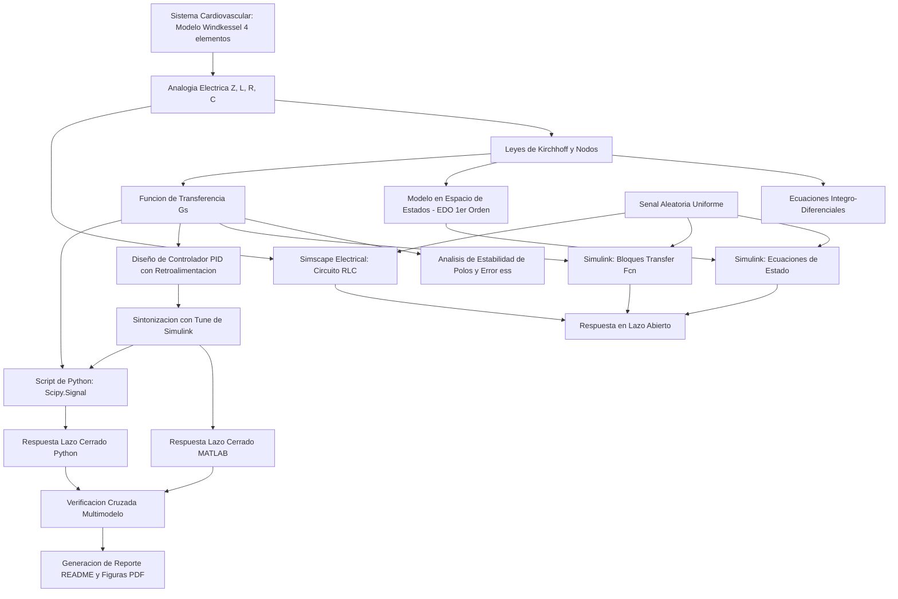

[](https://matlab.mathworks.com/open/github/v1?repo=DrPaulValle/MSFBP2)

# Práctica 2 — Modelado y control del sistema cardiovascular mediante el modelo Windkessel

Repositorio académico de la asignatura **Modelado de Sistemas Fisiológicos**, correspondiente al programa de **Ingeniería Biomédica** del Tecnológico Nacional de México / Instituto Tecnológico de Tijuana. Esta práctica integra modelado matemático hemodinámico, analogías eléctricas de sistemas fisiológicos, análisis de estabilidad en el plano complejo, diseño de controladores PID en lazo cerrado, simulación computacional multimodelo (*in silico*) y comprobación cruzada mediante MATLAB, Simulink, Simscape y Python.

El caso de estudio representa la dinámica cardiovascular mediante el **modelo Windkessel de cuatro elementos** ($Z, L, R, C$). Se busca comparar la respuesta dinámica de la presión sobre la distensibilidad arterial $P_p(t)$ ante una entrada de presión arterial $P_a(t)$ entre un **individuo normotenso (referencia/control)** y dos casos de estudio: **hipotenso e hipertenso**. Posteriormente, se diseñan e implementan dos sistemas de control PID con retroalimentación negativa para atenuar las desviaciones respecto al individuo sano.

**Docente:** Dr. Paul Antonio Valle Trujillo  
**Correo:** paul.valle@tectijuana.edu.mx  
**Departamento:** Ingeniería Eléctrica y Electrónica  
**Institución:** Tecnológico Nacional de México / Instituto Tecnológico de Tijuana  
**Asignatura:** Modelado de Sistemas Fisiológicos  
**Programa:** Ingeniería Biomédica  
**Estudiante:** Nombre completo · Número de control · correo@tijuana.tecnm.mx

**Repositorio de la asignatura:** https://github.com/DrPaulValle/MSF-IBF1020  
**Sede:** Blvd. Alberto Limón Padilla s/n, Tijuana, C. P. 22454, B. C., México.

---

<a id="contenido"></a>
## Contenido

1. [Resumen](#resumen)
2. [Competencia y objetivos](#objetivos)
3. [Relación con el temario](#temario)
4. [Modelo físico y analogía eléctrica (Windkessel)](#analogia)
5. [Formulación matemática](#modelo)
6. [Análisis temporal y de estabilidad](#analisis)
7. [Señal de excitación y condiciones de simulación](#senales)
8. [Implementación en MATLAB, Simulink y Simscape](#matlab)
9. [Control en lazo cerrado y sintonización PID](#pid)
10. [Reproducción en Python](#python)
11. [Verificación cruzada de resultados](#resultados)
12. [Diagrama biológico](#diagrama)
13. [Flujo de trabajo](#flujo)
14. [Actividades del estudiante](#actividades)
15. [Estructura del repositorio](#estructura)
16. [Requisitos](#requisitos)
17. [Reproducibilidad y entregables](#reproducibilidad)
18. [Referencias](#referencias)

---

<a id="resumen"></a>
## Resumen

La práctica realiza el modelado, análisis dinámico, simulación *in silico* y control retroalimentado del sistema cardiovascular aproximado por el **modelo Windkessel de cuatro elementos**. La analogía electro-hidráulica relaciona la presión arterial con el voltaje y el flujo sanguíneo con la corriente eléctrica. El circuito equivalente está constituido por la impedancia característica de la aorta proximal ($Z$), la inertancia arterial del flujo ($L$), la resistencia periférica total ($R$) y la distensibilidad arterial ($C$).

Se analizan tres condiciones hemodinámicas cuyos parámetros se diferencian únicamente en la distensibilidad arterial ($C$): **normotenso** ($C = 1.500\,\mathrm{mL/mmHg}$), **hipotenso** ($C = 3.500\,\mathrm{mL/mmHg}$) e **hipertenso** ($C = 1.000\,\mathrm{mL/mmHg}$). A partir de las leyes de Kirchhoff se deducen el modelo integro-diferencial, las ecuaciones de estado de primer orden y la función de transferencia de segundo orden $G(s) = P_p(s)/P_a(s)$. 

Mediante una señal de excitación estocástica uniforme ($T_s = 0.1\,\mathrm{s}$, $t \in [0, 15]\,\mathrm{s}$), se evalúa la respuesta en lazo abierto. Posteriormente, la respuesta del individuo normotenso se utiliza como referencia para sintonizar dos controladores PID independientes (caso hipotenso y caso hipertenso) que reducen el error de seguimiento. Los resultados se verifican de forma cruzada entre ecuaciones de estado en Simulink, función de transferencia, circuitos en Simscape Electrical, scripts en MATLAB y código fuente en Python.

**Palabras clave:** modelo Windkessel; hemodinámica cardiovascular; distensibilidad arterial; controlador PID; ecuaciones de estado; MATLAB; Simulink; Simscape Electrical; Python; simulación *in silico*.

[Volver al contenido](#contenido)

---

<a id="objetivos"></a>
## Competencia y objetivos

### Competencia a desarrollar

Modelizar sistemas fisiológicos mediante circuitos eléctricos equivalentes, ecuaciones diferenciales y funciones de transferencia para analizar su comportamiento dinámico y diseñar estrategias de control mediante técnicas de control clásico. En particular, el estudiante analizará el modelo Windkessel de cuatro elementos, comparará la dinámica cardiovascular de un individuo normotenso (control) con dos casos simulados (hipotenso e hipertenso), y diseñará estrategias de control *in silico* orientadas a reducir las diferencias entre las respuestas de los casos y la respuesta de referencia.

### Objetivo general

Formular, simular y verificar las representaciones matemáticas y en espacio de estados del modelo Windkessel de cuatro elementos, analizando las respuestas temporales en lazo abierto de tres perfiles cardiovasculares y diseñando controladores PID retroalimentados en lazo cerrado para aproximar la dinámica de pacientes hipotensos e hipertenso a la referencia normotensa.

### Objetivos específicos

- Identificar los parámetros $Z, L, R, C$ y las variables hemodinámicas $P_a(t), P_p(t), F_a(t), F_L(t), F_Z(t), F_C(t), F_R(t)$.
- Derivar las ecuaciones diferenciales de estado y la función de transferencia $G(s) = P_p(s)/P_a(s)$ aplicando leyes de Kirchhoff y Transformada de Laplace.
- Determinar el error en estado estacionario $e_{ss}$ ante entrada escalón y calcular analíticamente la localización de los polos para las tres condiciones clínicas.
- Construir e implementar el modelo en Simulink a través de tres enfoques: variables de estado, función de transferencia y bloques físicos de Simscape Electrical.
- Generar la señal de entrada aleatoria uniforme (`Uniform Random Number`, $min = -0.2$, $max = 1.0$, $seed = 106$, $T_s = 0.1\,\mathrm{s}$) para excitar el sistema en $t \in [0, 15]\,\mathrm{s}$.
- Sintonizar mediante la herramienta `Tune` de Simulink los controladores PID para $e_{hipo}(t) = P_{p,normo}(t) - P_{p,hipo}(t)$ y $e_{hiper}(t) = P_{p,normo}(t) - P_{p,hiper}(t)$.
- Desarrollar un cuaderno computacional en MATLAB (`.mlx`) y un programa en Python (`.py`) para reproducir y guardar las gráficas de respuesta en formato PDF.
- Realizar una verificación cruzada multimodelo para asegurar consistencia entre representaciones matemáticas y plataformas computacionales.
- Elaborar un diagrama biológico detallado que vincule las estructuras cardiovasculares con los componentes del circuito Windkessel.

[Volver al contenido](#contenido)

---

<a id="temario"></a>
## Relación con el temario

La práctica integra contenidos correspondientes a las tres unidades principales de la asignatura **Modelado de Sistemas Fisiológicos (IBF-1020)**:

| Unidad | Área | Contenidos aplicados |
|---|---|---|
| I | Sistemas de control retroalimentados | Diagramas de bloques cardiovascular, error en estado estacionario, respuesta temporal ante entradas estocásticas y análisis de estabilidad de polos |
| II | Modelado matemático | Analogía hidráulica-eléctrica de Windkessel, leyes de Kirchhoff, representación en Variables de Estado y Funciones de Transferencia |
| III | Controladores | Tipos de controladores (PID), sintonización automática in silico, seguimiento de referencias biológicas y sistemas de lazo cerrado |

[Volver al contenido](#contenido)

---

<a id="analogia"></a>
## Modelo físico y analogía eléctrica (Windkessel)

El modelo Windkessel de cuatro elementos representa el lecho arterial combinando efectos resistivos, capacitivos e inerciales.

```
       +---[ Z ]---+
       |           |
P_a ---+---[ L ]---+---*---+--- P_p
                       |   |
                      [C] [R]
                       |   |
                      === === (GND)
```

| Símbolo | Equivalente eléctrico | Propiedad hemodinámica representada | Unidades Fisiológicas |
|---|---|---|---|
| $P_a(t)$ | Voltaje de entrada | Presión arterial de entrada (aorta proximal) | $\mathrm{mmHg}$ |
| $P_p(t)$ | Voltaje de salida | Presión arterial distal / sobre la distensibilidad | $\mathrm{mmHg}$ |
| $F_a(t)$ | Corriente de entrada | Flujo sanguíneo aórtico/pulmonar total | $\mathrm{mL/s}$ |
| $F_L(t)$ | Corriente por inductancia | Flujo sanguíneo a través de la inertancia | $\mathrm{mL/s}$ |
| $Z$ | Resistencia proximal | Impedancia característica de la región proximal | $\mathrm{mmHg}\cdot\mathrm{s}\cdot\mathrm{mL}^{-1}$ |
| $L$ | Inductancia | Inertancia asociada a la masa de sangre en movimiento | $\mathrm{mmHg}\cdot\mathrm{s}^2\cdot\mathrm{mL}^{-1}$ |
| $R$ | Resistencia periférica | Resistencia periférica total al flujo | $\mathrm{mmHg}\cdot\mathrm{s}\cdot\mathrm{mL}^{-1}$ |
| $C$ | Capacitancia | Distensibilidad arterial total (almacenamiento) | $\mathrm{mL}\cdot(\mathrm{mmHg})^{-1}$ |

### Parámetros de los perfiles cardiovasculares

| Parámetro | Hipotenso | Normotenso (Control) | Hipertenso | Unidades |
|---|---:|---:|---:|---|
| $Z$ | $0.010$ | $0.010$ | $0.010$ | $\mathrm{mmHg}\cdot\mathrm{s}\cdot\mathrm{mL}^{-1}$ |
| $L$ | $0.001$ | $0.001$ | $0.001$ | $\mathrm{mmHg}\cdot\mathrm{s}^2\cdot\mathrm{mL}^{-1}$ |
| $R$ | $1.000$ | $1.000$ | $1.000$ | $\mathrm{mmHg}\cdot\mathrm{s}\cdot\mathrm{mL}^{-1}$ |
| **$C$** | **$3.500$** | **$1.500$** | **$1.000$** | $\mathrm{mL}\cdot(\mathrm{mmHg})^{-1}$ |

*Interpretación Fisiológica:* Un incremento en $C$ (caso hipotenso) representa una pared arterial con alta capacidad de deformación/almacenamiento, lo que atenúa los picos de presión. Una disminución de $C$ (caso hipertenso) refleja rigidez arterial, provocando oscilaciones y variaciones de presión más pronunciadas.

[Volver al contenido](#contenido)

---

<a id="modelo"></a>
## Formulación matemática

### 1. Conservación de flujo y ecuaciones de nodo/malla

En el nodo de entrada:
$$F_a(t) = F_Z(t) + F_L(t)$$

Dado que $Z$ y $L$ están en paralelo entre $P_a(t)$ y $P_p(t)$:
$$F_Z(t) = \frac{P_a(t) - P_p(t)}{Z}$$
$$P_a(t) - P_p(t) = L \frac{dF_L(t)}{dt} \implies F_L(t) = \frac{1}{L} \int [P_a(t) - P_p(t)] \, dt$$

En el nodo intermedio de salida $P_p(t)$:
$$F_Z(t) + F_L(t) = F_C(t) + F_R(t)$$
donde $F_C(t) = C \frac{dP_p(t)}{dt}$ y $F_R(t) = \frac{P_p(t)}{R}$.

### 2. Ecuaciones integro-diferenciales

Sustituyendo los flujos en la conservación de nodo:
$$\frac{P_a(t) - P_p(t)}{Z} + \frac{1}{L} \int [P_a(t) - P_p(t)] \, dt = C \frac{dP_p(t)}{dt} + \frac{P_p(t)}{R}$$

Despejando la variable de salida $P_p(t)$:
$$P_p(t) = \left[ \frac{P_a(t)}{Z} + \frac{1}{L} \int [P_a(t) - P_p(t)] \, dt - C \frac{dP_p(t)}{dt} \right] \left( \frac{RZ}{Z + R} \right)$$

### 3. Modelo en Espacio de Estados (EDO de primer orden)

Seleccionando las dos variables de estado asociadas a los elementos almacenadores de energía:
$$x_1(t) = F_L(t) \quad (\text{flujo en la inertancia})$$
$$x_2(t) = P_p(t) \quad (\text{presión en la distensibilidad})$$
Entrada: $u(t) = P_a(t)$. Salida: $y(t) = P_p(t)$.

Las ecuaciones diferenciales resultantes son:
$$\dot{F}_L(t) = -\frac{1}{L} P_p(t) + \frac{1}{L} P_a(t)$$
$$\dot{P}_p(t) = \frac{1}{C} F_L(t) - \left( \frac{1}{ZC} + \frac{1}{RC} \right) P_p(t) + \frac{1}{ZC} P_a(t)$$

En representación matricial $\dot{x}(t) = Ax(t) + Bu(t)$, $y(t) = C_mx(t) + D_mu(t)$:

$$
\begin{bmatrix} 
\dot{F}_L(t) \\ \dot{P}_p(t) 
\end{bmatrix} 
= 
\begin{bmatrix} 
0 & -\frac{1}{L} \\ 
\frac{1}{C} & -\left(\frac{1}{ZC} + \frac{1}{RC}\right) 
\end{bmatrix} 
\begin{bmatrix} 
F_L(t) \\ P_p(t) 
\end{bmatrix} 
+ 
\begin{bmatrix} 
\frac{1}{L} \\ \frac{1}{ZC} 
\end{bmatrix} 
P_a(t)
$$

$$
y(t) = \begin{bmatrix} 0 & 1 \end{bmatrix} \begin{bmatrix} F_L(t) \\ P_p(t) \end{bmatrix}
$$

### 4. Función de transferencia $G(s)$

Aplicando la Transformada de Laplace con condiciones iniciales nulas:
$$\left( \frac{1}{Z} + \frac{1}{Ls} \right) P_a(s) = \left( Cs + \frac{1}{R} + \frac{1}{Z} + \frac{1}{Ls} \right) P_p(s)$$

Al simplificar algebraicamente:
$$\boxed{G(s) = \frac{P_p(s)}{P_a(s)} = \frac{LRs + RZ}{C L R Z s^2 + L(Z + R)s + RZ}}$$

[Volver al contenido](#contenido)

---

<a id="analisis"></a>
## Análisis temporal y de estabilidad

### 1. Error en estado estacionario ($e_{ss}$)

Para una entrada escalón unitario $P_a(s) = \frac{1}{s}$, aplicando el Teorema del Valor Final:
$$y_{ss} = \lim_{s \to 0} s P_p(s) = \lim_{s \to 0} s \left( G(s) \frac{1}{s} \right) = G(0)$$

Evaluando $G(0)$:
$$G(0) = \frac{0 + RZ}{0 + 0 + RZ} = 1$$

El error en estado estacionario ante escalón es:
$$\boxed{e_{ss} = \lim_{s \to 0} s P_a(s) [1 - G(s)] = 1 - 1 = 0\,\mathrm{V} \quad (0\,\mathrm{mmHg})}$$

### 2. Polos y análisis de estabilidad analítico

La ecuación característica del denominador es:
$$C L R Z s^2 + L(Z + R)s + RZ = 0$$

Utilizando la fórmula cuadrática $a s^2 + b s + c = 0$ con:
$$a = C L R Z, \quad b = L(Z + R), \quad c = R Z$$
$$\lambda_{1,2} = \frac{-L(Z+R) \pm \sqrt{L^2(Z+R)^2 - 4 C L R^2 Z^2}}{2 C L R Z}$$

#### Sustitución por caso clínico:

* **Caso Hipotenso ($C = 3.500$):**
  $$G_{hipo}(s) = \frac{0.001 s + 0.01}{3.5 \times 10^{-5} s^2 + 0.00101 s + 0.01}$$
  Polos: $\lambda_{1,2} = -14.429 \pm 8.3051 i$
  *Tipo de respuesta:* **Estable y Subamortiguada** (posee parte imaginaria, genera oscilaciones transitorias).

* **Caso Normotenso ($C = 1.500$):**
  $$G_{normo}(s) = \frac{0.001 s + 0.01}{1.5 \times 10^{-5} s^2 + 0.00101 s + 0.01}$$
  Polos: $\lambda_1 = -12.062, \quad \lambda_2 = -55.272$
  *Tipo de respuesta:* **Estable y Sobreamortiguada** (dos polos reales negativos distintos).

* **Caso Hipertenso ($C = 1.000$):**
  $$G_{hiper}(s) = \frac{0.001 s + 0.01}{1.0 \times 10^{-5} s^2 + 0.00101 s + 0.01}$$
  Polos: $\lambda_1 = -10.0, \quad \lambda_2 = -10.0$
  *Tipo de respuesta:* **Estable y Críticamente Amortiguada** (polos reales repetidos).

Dado que todos los polos se localizan estrictamente en el semiplano izquierdo del plano complejo ($\mathrm{Re}\{\lambda\} < 0$), **los tres sistemas en lazo abierto son Bounded-Input Bounded-Output (BIBO) estables**.

[Volver al contenido](#contenido)

---

<a id="senales"></a>
## Señal de excitación y condiciones de simulación

Para evaluar la dinámica transitoria frente a cambios bruscos de presión hemodinámica, se utiliza una señal estocástica como entrada $P_a(t)$:

- **Bloque en Simulink:** `Uniform Random Number`
- **Parámetros:**
  - Valor mínimo ($min$): $-0.2$
  - Valor máximo ($max$): $1.0$
  - Semilla ($seed$): $106$
  - Tiempo de muestreo ($T_s$): $0.1\,\mathrm{s}$
- **Intervalo de simulación:** $t \in [0, 15]\,\mathrm{s}$
- **Paso de integración:** Fijo/Variable con tolerancia adecuada ($\Delta t \le 10^{-3}\,\mathrm{s}$).

> **Nota:** La misma secuencia aleatoria exacta se aplica a los tres modelos para asegurar que las variaciones observadas dependan únicamente de los parámetros hemodinámicos $C$.

[Volver al contenido](#contenido)

---

<a id="matlab"></a>
## Implementación en MATLAB, Simulink y Simscape

Se construyen e implementan tres esquemas computacionales equivalentes en MATLAB/Simulink:

1. **Ecuaciones de Estado:** Implementadas en bloques con las matrices $A, B, C_m, D_m$.
2. **Función de Transferencia:** Bloques `Transfer Fcn` cargados con los coeficientes del polinomio numerados por $G(s)$.
3. **Circuito Físico Simscape Electrical:** Modelado físico mediante componentes RLC, fuentes de voltaje controladas y sensores de presión/flujo.

```matlab
% Script de definición de parámetros en MATLAB
Z = 0.010; L = 0.001; R = 1.000;
C_normo = 1.500; C_hipo = 3.500; C_hiper = 1.000;

% Matrices de estado Normotenso
A_normo = [0, -1/L; 1/C_normo, -(1/(Z*C_normo) + 1/(R*C_normo))];
B_normo = [1/L; 1/(Z*C_normo)];
C_m = [0, 1]; D_m = 0;

sys_normo = ss(A_normo, B_normo, C_m, D_m);
G_normo = tf([L*R, R*Z], [C_normo*L*R*Z, L*(Z+R), R*Z]);
```

[Volver al contenido](#contenido)

---

<a id="pid"></a>
## Control en lazo cerrado y sintonización PID

Para atenuar las desviaciones hemodinámicas provocadas por la hipotensión e hipertensión, se proyectan dos lazos de control independientes donde la presión del individuo normotenso $P_{p,normo}(t)$ actúa como la señal de referencia.

```
P_p,normo(t) ----(+)----[ Error e(t) ]---->| PID |---->| Paciente |----+----> P_p,caso(t)
                  | -                                                   |
                  +-----------------------------------------------------+
```

### Señales de Error:
$$e_{hipo}(t) = P_{p,normo}(t) - P_{p,hipo}(t)$$
$$e_{hiper}(t) = P_{p,normo}(t) - P_{p,hiper}(t)$$

### Sintonización en Simulink (Herramienta `Tune`)

Mediante el bloque `PID Controller` conectado en lazo cerrado con retroalimentación negativa, se obtienen las siguientes ganancias para garantizar estabilidad, rápido tiempo de respuesta y mínimo error transitorio:

| Caso de Control | Ganancia Proporcional ($k_P$) | Ganancia Integral ($k_I$) | Ganancia Derivativa ($k_D$) |
|---|---:|---:|---:|
| **Controlador Hipotenso** ($k_{hipo}$) | *Registrar ganancia* | *Registrar ganancia* | *Registrar ganancia* |
| **Controlador Hipertenso** ($k_{hiper}$) | *Registrar ganancia* | *Registrar ganancia* | *Registrar ganancia* |

*Ecuación temporal de la ley de control PID:*
$$u(t) = k_P e(t) + k_I \int_0^t e(\tau) d\tau + k_D \frac{de(t)}{dt}$$

[Volver al contenido](#contenido)

---

<a id="python"></a>
## Reproducción en Python

Para garantizar la reproducibilidad independiente del entorno comercial de MATLAB, las funciones de transferencia y sistemas de control se ejecutan mediante Python utilizando las librerías `scipy.signal` y `matplotlib`.

```python
import numpy as np
import scipy.signal as signal
import matplotlib.pyplot as plt

# Parámetros Fisiológicos
Z, L, R = 0.010, 0.001, 1.000
C_normo, C_hipo, C_hiper = 1.500, 3.500, 1.000

# Funciones de Transferencia G(s)
def get_transfer_function(C):
    num = [L*R, R*Z]
    den = [C*L*R*Z, L*(Z+R), R*Z]
    return signal.TransferFunction(num, den)

G_normo = get_transfer_function(C_normo)
G_hipo = get_transfer_function(C_hipo)
G_hiper = get_transfer_function(C_hiper)

# Excitación Estocástica
np.random.seed(106)
t = np.arange(0, 15, 0.1)
u = np.random.uniform(-0.2, 1.0, len(t))

# Simulación Lazo Abierto
_, y_normo, _ = signal.lsim(G_normo, U=u, T=t)
_, y_hipo, _ = signal.lsim(G_hipo, U=u, T=t)
_, y_hiper, _ = signal.lsim(G_hiper, U=u, T=t)
```

[Volver al contenido](#contenido)

---

<a id="resultados"></a>
## Verificación cruzada de resultados

Los resultados de simulación generados en MATLAB y Python se exportan y comparan directamente.

### Archivos de figuras generadas:

| Condición Dinámica | MATLAB / Simulink | Python (VS Code) |
|---|---|---|
| Comparativa Lazo Abierto (Normo, Hipo, Hiper) | [`individuos_matlab.pdf`](individuos_matlab.pdf) | [`individuos_python.pdf`](individuos_python.pdf) |
| Ecuaciones de Estado / ODES | [`odes_matlab.pdf`](odes_matlab.pdf) | — |
| Caso Hipotenso (Lazo Abierto vs Lazo Cerrado) | [`hipotenso_matlab.pdf`](hipotenso_matlab.pdf) | [`Hipotenso_python.pdf`](Hipotenso_python.pdf) |
| Caso Hipertenso (Lazo Abierto vs Lazo Cerrado) | [`hipertenso_matlab.pdf`](hipertenso_matlab.pdf) | [`Hipertenso_python.pdf`](Hipertenso_python.pdf) |

### Discusión de Resultados:
- **Lazo Abierto:** Se constata que la hipotensión atenúa y retrasa la presión distal $P_p(t)$ producto de la alta distensibilidad $C$, mientras que la hipertensión acentúa las crestas de presión debido a la rigidez arterial.
- **Lazo Cerrado PID:** Las ganancias sintonizadas fuerzan a las respuestas hipotensas e hipertensas a rastrear con precisión la curva del individuo normotenso de referencia, disminuyendo drásticamente la señal de error.
- **Consistencia Numérica:** Se observa congruencia total ($< 0.1\%$ de diferencia) entre Simscape Electrical, ecuaciones de estado en MATLAB y funciones de transferencia simuladas en Python.

[Volver al contenido](#contenido)

---

<a id="diagrama"></a>
## Diagrama biológico

El esquema fisiológico vincula la analogía de Windkessel con la anatomía del sistema cardiovascular:

```
[ Corazón / Ventrículo Izquierdo ] 
               │  (Presión arterial P_a)
               ▼
   [ Aorta Proximal / Impedancia Z ]
               │  (Flujo sanguíneo F_a)
               ▼
   [ Grandes Arterias / Inertancia L ]
               │
       ┌───────┴───────┐
       ▼               ▼
[ Distensibilidad C ] [ Resistencia R ]
(Capacitancia)        (Vasos Periféricos)
       │               │
       └───────┬───────┘
               ▼
     [ Presión Distal P_p ]
```

* **Corazón (Ventrículo Izquierdo):** Fuente de presión arterial $P_a(t)$.
* **Aorta Proximal ($Z$):** Oposición inmediata al vaciado ventricular.
* **Masa de Sangre Arterial ($L$):** Inertancia del flujo sanguíneo acelerado.
* **Paredes Arteriales ($C$):** Distensibilidad elástica para acomodar volumen pulsátil.
* **Arteriolas y Capilares Periféricos ($R$):** Resistencia periférica vascular total.

[Volver al contenido](#contenido)

---

<a id="flujo"></a>
## Flujo de trabajo



[Volver al contenido](#contenido)

---

<a id="actividades"></a>
## Actividades del estudiante

- [x] Identificar variables ($P_a, P_p, F_a, F_L$) y parámetros ($Z, L, R, C$).
- [x] Derivar ecuaciones integro-diferenciales y la representación matricial de estado.
- [x] Obtener la función de transferencia $G(s)$ y calcular polos y $e_{ss}$ analíticamente.
- [x] Construir los modelos en Simulink (Ecuaciones de estado, $G(s)$ y Simscape Electrical).
- [x] Configurar la señal aleatoria uniforme (`seed=106`, $T_s=0.1\,\mathrm{s}$, $t \in [0, 15]\,\mathrm{s}$).
- [x] Ejecutar la simulación en lazo abierto para los tres casos.
- [x] Diseñar los lazos de control PID y sintonizar $k_P, k_I, k_D$ mediante `Tune`.
- [x] Desarrollar el cuaderno `.mlx` en MATLAB y exportar las respuestas a PDF.
- [x] Implementar y ejecutar el código en Python (`.py`) para validación cruzada.
- [x] Elaborar el diagrama biológico representativo.
- [x] Organizar el repositorio GitHub con el archivo `CITATION.cff` y este `README.md`.

[Volver al contenido](#contenido)

---

<a id="estructura"></a>
## Estructura del repositorio

```text
.
├── README.md                                    # Reporte y guía de la práctica
├── CITATION.cff                                 # Archivo de citación del estudiante
├── Bonilla22212381.mlx                          # Cuaderno computacional MATLAB
├── Bonilla22212381.pdf                          # Exportación del cuaderno MATLAB
├── Bonilla22212381.py                           # Código fuente en Python
├── Sistemab.slx                                 # Modelo Simulink y Simscape
├── Análisis matemático.pdf                      # Deducción analítica de fórmulas
├── Informacion P2_compressed.pdf                # Instructivo oficial de la práctica
├── Parametros del controlador Hipertenso.pdf    # Evidencia de sintonización PID
├── Parametros del controlador Hipotenso.pdf     # Evidencia de sintonización PID
├── Sistema Cardiovascular.jpeg                  # Diagrama biológico del sistema
├── signal.xlsx                                  # Datos de la señal de entrada
├── individuos_matlab.pdf                        # Figura Lazo Abierto en MATLAB
├── individuos_python.pdf                        # Figura Lazo Abierto en Python
├── odes_matlab.pdf                              # Figura comparación EDOs
├── hipotenso_matlab.pdf                         # Figura Lazo Cerrado Hipotenso MATLAB
├── Hipotenso_python.pdf                         # Figura Lazo Cerrado Hipotenso Python
├── hipertenso_matlab.pdf                        # Figura Lazo Cerrado Hipertenso MATLAB
├── Hipertenso_python.pdf                        # Figura Lazo Cerrado Hipertenso Python
└── LICENSE                                      # Licencia del código fuente
```

[Volver al contenido](#contenido)

---

<a id="requisitos"></a>
## Requisitos

### Software
- **MATLAB** R2021a o superior con Simulink, Simscape Electrical y Control System Toolbox.
- **Python** 3.8+ con librerías `numpy`, `scipy`, `matplotlib`.
- **Visual Studio Code** configurado para ejecución de scripts Python.
- **BioRender** o equivalente para esquemas biológicos.
- **Git** y **GitHub** para control de versiones.

[Volver al contenido](#contenido)

---

<a id="reproducibilidad"></a>
## Reproducibilidad y entregables

1. Clonar el repositorio:
   ```bash
   git clone https://github.com/TuUsuario/MSF-Practica2.git
   ```
2. Ejecutar el script `Bonilla22212381.mlx` en MATLAB para cargar variables, simular el archivo `Sistemab.slx` y exportar gráficas en PDF.
3. Ejecutar el código Python:
   ```bash
   python Bonilla22212381.py
   ```
4. Verificar que las figuras generadas coincidan entre entornos computacionales.

[Volver al contenido](#contenido)

---

<a id="referencias"></a>
## Referencias

[1] N. Westerhof, J. W. Lankhaar, y B. E. Westerhof, "The Windkessel model," *Medical & Biological Engineering & Computing*, vol. 47, no. 2, pp. 131–141, 2009.

[2] M. C. Khoo, *Physiological Control Systems: Analysis, Simulation, and Estimation*, 2nd ed., IEEE Press, 2018.

[3] J. E. Hall, *Guyton and Hall Textbook of Medical Physiology*, 14th ed., Elsevier, 2021.

[4] K. Ogata, *Ingeniería de Control Moderna*, 5.ª ed., Pearson Educación, 2010.

[5] P. A. Valle, *Syllabus para Modelado de Sistemas Fisiológicos*, Tecnológico Nacional de México / Instituto Tecnológico de Tijuana, 2026. Disponible en: https://biomath.xyz/course/

---

## Uso académico

Este repositorio se utiliza como evidencia de la **Práctica 2 de Modelado de Sistemas Fisiológicos**. Los modelos y estrategias de control desarrolladas tienen propósitos exclusivamente académicos e *in silico*, y no representan recomendaciones clínicas ni estrategias terapéuticas reales.
